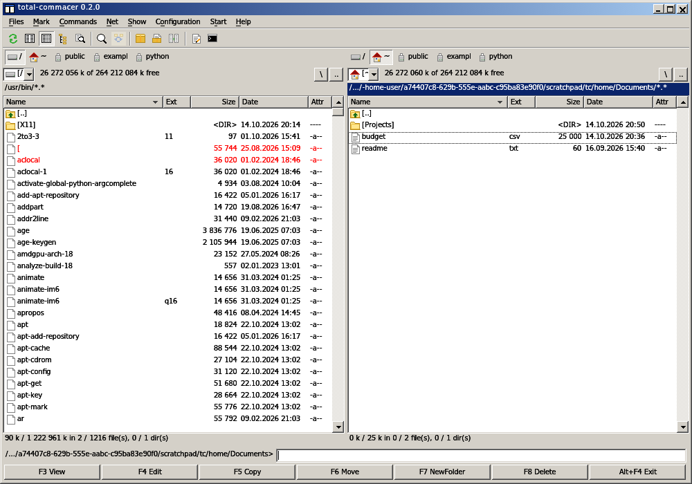
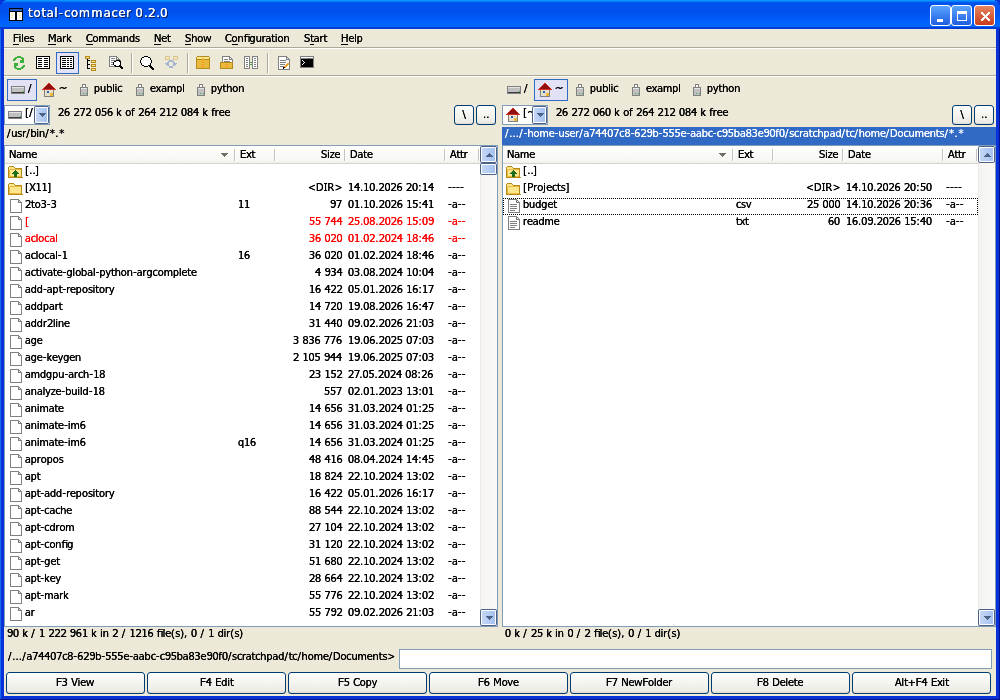

# total-commacer

A two-panel file manager that looks and behaves like the one everybody used on
Windows 2000 and XP — written from scratch in Rust, for macOS, Linux and Windows.

**Windows Classic** (the default): grey face, the navy-to-sky-blue caption, square
3D buttons.



**Windows XP**: the Luna theme with its blue frame, rounded caption buttons and the
orange hover glow.



Switch between them in Configuration → Options → Look. The choice is saved in the
ini file and the program starts in whichever you picked.

* Both looks are drawn pixel by pixel: 3D bevels, gradient captions, dithered
  scrollbar tracks, bracketed `[directories]`, red marked files, the dotted cursor.
* Total Commander's keyboard layout: F3–F8, Alt+F4, Tab, Insert/Space, Num +/−/\*,
  Ctrl+F1/F2 brief/full, Ctrl+F3–F7 sorting, Alt+F1/F2 drives, Alt+F7 find,
  Alt+Enter properties, Ctrl+Left/Right, Ctrl+B branch view, Ctrl+T/W tabs,
  Ctrl+D hotlist, Ctrl+Alt+letter quick search, letters to the command line …
  (Help > Keyboard lists them all.)
* Lister (F3) with text / binary / hex, ZIP pack (Alt+F5) and unpack (Alt+F9),
  find files with "feed to listbox", quick view (Ctrl+Q), compare directories (Shift+F2).
* Settings live in an ini file: `~/.config/total-commacer/wincmd.ini`
  (`%APPDATA%\total-commacer\wincmd.ini` on Windows); `Theme=classic` or `Theme=xp`
  picks the look.

Not affiliated with Total Commander or C. Ghisler & Co. No code, icons or images
from any other program are used; the icons are drawn here, and the font is the
Wine project's Tahoma-compatible face (LGPL, see `assets/fonts/`).

## Download

Prebuilt binaries for Windows, macOS (Apple Silicon and Intel) and Linux are on the
[Releases](https://github.com/axelsharper/total-commacer/releases) page. They are not
code-signed: Windows SmartScreen wants "More info → Run anyway", and macOS needs
`xattr -d com.apple.quarantine total-commacer` once before the first start.

## Build

```
cargo run --release
```

Rust 1.80+ and no system dependencies beyond a working OpenGL. On Linux the
`.cargo/config.toml` points cargo at the git index of crates.io, which also works
where the sparse index is blocked.

## Status

Early. Works for everyday file management; FTP, plugins, synchronize dirs,
multi-rename and the tree are on the list, not in the program.
